  

  &nbsp;
  &nbsp;
  

## `whoami`

*student by day, operator by night — turning repeated work into scripts, and trusting nothing by default.*

## `cat ~/stack.json`

  

## `ls -l ~/projects`

| bin | what it does | type |
|---|---|:---:|
| **[servercapture-cors](https://github.com/kripto-geek/servercapture-cors)** | cross-origin pain, crossed out | `net` |
| **[TH-git-j-script](https://github.com/kripto-geek/TH-git-j-script)** | git chores → shell one-liners | `ops` |
| **[graphql-cors](https://github.com/kripto-geek/graphql-cors)** | GraphQL with the gates locked | `sec` |
| **[mysql-go-api](https://github.com/kripto-geek/mysql-go-api)** | go + mysql, wired tight | `api` |
| **[todo-eth](https://github.com/kripto-geek/todo-eth)** | to-dos, but on-chain and immutable | `web3` |

🔗 [every other binary lives here](https://github.com/kripto-geek?tab=repositories)

## `tail -f ~/.stats`

  
  

  
  &nbsp;
  

  

